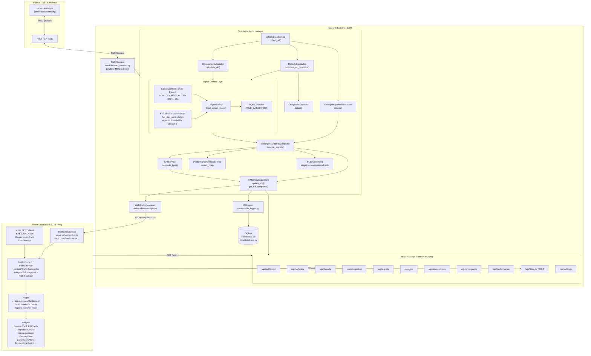

# System Architecture Diagram

> **Files read to produce this diagram:**
> - `backend/app/main.py` — lifespan setup, service wiring, simulation loop, WebSocket endpoint
> - `backend/app/services/traci_session.py` — TraCI / SUMO connection and mock-mode fallback
> - `backend/app/services/signal_controller.py` — rule-based timing (density→duration)
> - `backend/app/controllers/dqn_controller.py` — DQN / RULE_BASED mode switching, `ControllerMode` enum
> - `backend/app/controllers/fyp_dqn_controller.py` — final obs-v2 Double DQN model (loaded if available)
> - `backend/app/environment/signal_safety.py` — legal-action mask and safety constraints
> - `backend/app/services/priority_controller.py` — emergency vehicle override layer
> - `backend/app/core/database.py` — SQLite schema and `Database` class
> - `backend/app/websocket/manager.py` — `WebSocketManager.broadcast()`
> - `backend/app/api/routes/__init__.py` — all REST routers under `/api`
> - `backend/app/core/state_store.py` — `InMemoryStateStore`
> - `frontend/src/services/api.ts` — REST client (`BASE_URL = '/api'`)
> - `frontend/src/services/websocket.ts` — `TrafficWebSocket` with reconnect
> - `frontend/src/context/TrafficContext.tsx` — `TrafficProvider`, merges WS + REST data
> - `frontend/src/App.tsx` — routes and auth gate

## Component Responsibilities

| Component | File(s) | Role |
|---|---|---|
| SUMO | `sumo/config/intelliroads.sumocfg` | Microscopic traffic simulation; 4-junction network |
| TraCISession | `services/traci_session.py` | Opens TraCI TCP connection; falls back to synthetic mock data if SUMO absent |
| Simulation loop | `main.py: simulate_loop()` | Orchestrates one tick per second; calls all services in order |
| SignalController | `services/signal_controller.py` | Rule-based timing: density level → green duration |
| SignalSafety | `environment/signal_safety.py` | Legal-action mask (min/max green, yellow never shortened) |
| DQNController | `controllers/dqn_controller.py` | Wraps rule-based and DQN; selectable via `POST /api/rl/mode` |
| FYP obs-v2 controller | `controllers/fyp_dqn_controller.py` | Final trained Double DQN with safety layer; loaded from `.pt` checkpoint |
| EmergencyPriorityController | `services/priority_controller.py` | Overrides signal to 90 s GREEN at any junction with an active emergency vehicle |
| InMemoryStateStore | `core/state_store.py` | Thread-safe in-memory cache; source of truth for REST and WS |
| DBLogger | `services/db_logger.py` | Persists telemetry to SQLite after every tick |
| SQLite | `core/database.py` | 14-table schema; WAL mode |
| WebSocketManager | `websocket/manager.py` | Broadcasts full snapshot JSON to all connected clients every ~1 s |
| TrafficContext | `frontend/src/context/TrafficContext.tsx` | Maintains WS connection; falls back to polling REST every 5 s when WS drops |
