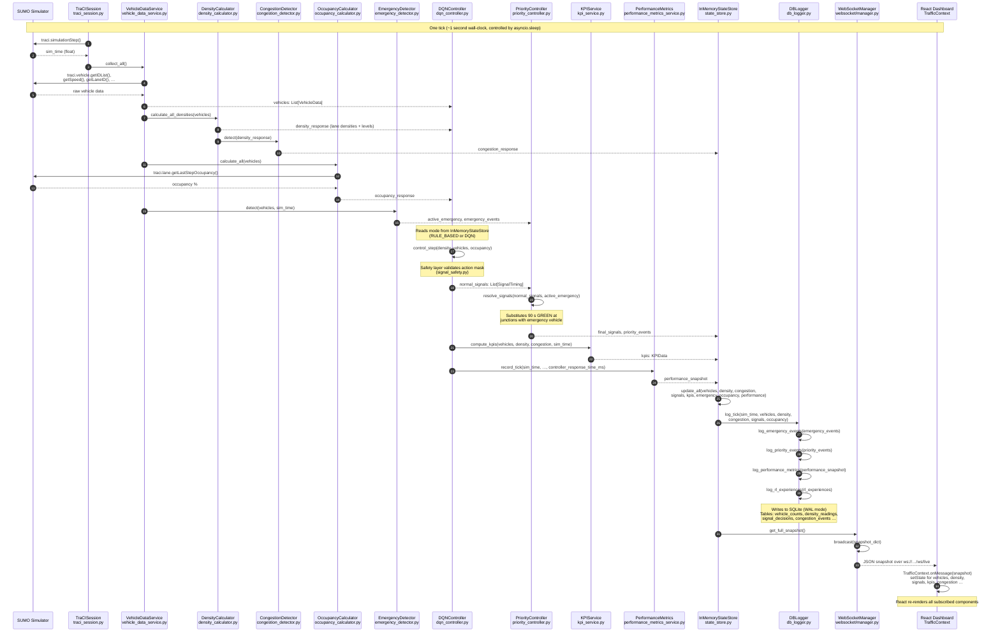

# Data Flow Diagrams

> **Files read to produce these diagrams:**
> - `backend/app/main.py` — `simulate_loop()` step-by-step ordering
> - `backend/app/services/traci_session.py` — `step()` advances SUMO time
> - `backend/app/services/vehicle_data_service.py` — `collect_all()`
> - `backend/app/services/density_calculator.py` — `calculate_all_densities()`
> - `backend/app/services/congestion_detector.py` — `detect()`
> - `backend/app/services/signal_controller.py` — `control_step()` / rule-based timing
> - `backend/app/controllers/dqn_controller.py` — `control_step()`, `set_mode()`
> - `backend/app/services/priority_controller.py` — `resolve_signals()`
> - `backend/app/core/state_store.py` — `update_all()`, `get_full_snapshot()`
> - `backend/app/services/db_logger.py` — `log_tick()`
> - `backend/app/websocket/manager.py` — `broadcast()`
> - `backend/app/api/routes/rl.py` — `POST /api/rl/mode`
> - `frontend/src/services/websocket.ts` — `TrafficWebSocket.onmessage`
> - `frontend/src/context/TrafficContext.tsx` — state update on snapshot

---

## Diagram 1 — One Simulation Tick (SUMO → Screen)

This shows what happens inside one iteration of `simulate_loop()` in `main.py` at ~1-second intervals.



---

## Diagram 2 — User Switches Standard Timing ↔ Smart AI

This shows the flow when a user clicks the **Standard timing / Smart AI** toggle on the dashboard (implemented in `TimingModeSwitch.tsx`, API call in `api.ts`, endpoint in `api/routes/rl.py`).

```mermaid
sequenceDiagram
    autonumber
    participant USER as User<br/>(browser)
    participant TMS as TimingModeSwitch<br/>widgets/TimingModeSwitch.tsx
    participant API_TS as api.ts<br/>apiPost('/api/rl/mode', …)
    participant RL_RT as /api/rl/mode<br/>api/routes/rl.py
    participant STORE as InMemoryStateStore<br/>core/state_store.py
    participant CTRL as DQNController<br/>controllers/dqn_controller.py
    participant SIMLOOP as Simulation Loop<br/>main.py

    USER->>TMS: clicks "Smart AI" button
    TMS->>TMS: setSwitching(true)
    TMS->>API_TS: POST /api/rl/mode  { mode: "DQN" }

    API_TS->>RL_RT: HTTP POST with Bearer token
    RL_RT->>RL_RT: validate mode string ("DQN" ∈ ControllerMode)
    RL_RT->>STORE: set_controller_mode("DQN")
    RL_RT->>CTRL: set_mode(ControllerMode.DQN)
    Note over CTRL: Mode is now DQN in memory;<br/>safety layer still active
    RL_RT-->>API_TS: 200 { mode: "DQN", previous_mode: "RULE_BASED" }

    API_TS-->>TMS: resolve with response
    TMS->>TMS: setMode("DQN"), setSwitching(false)
    TMS->>USER: button highlights "Smart AI" ✓

    Note over SIMLOOP: Next tick (≤1 s later)…
    SIMLOOP->>STORE: get_controller_mode()
    STORE-->>SIMLOOP: "DQN"
    SIMLOOP->>CTRL: set_mode("DQN") + control_step(…)
    Note over CTRL: FYP obs-v2 Double DQN selects action<br/>→ safety mask validates<br/>→ TraCI applies phase change to SUMO

    SIMLOOP->>STORE: update_all(signals=dqn_signals, …)
    SIMLOOP->>CTRL: broadcast(snapshot)
    CTRL-->>USER: WebSocket snapshot — signals now show DQN decisions

    Note over USER,SIMLOOP: Switching back to Standard timing<br/>follows the same path with mode="RULE_BASED"
```
