# Database Schema

> **Files read to produce this diagram:**
> - `backend/app/core/database.py` — contains the full `_SCHEMA` string that
>   creates all tables and indexes via `executescript`. Every table and column
>   below comes directly from that file. No columns or tables have been invented.

The SQLite database (`intelliroads.db`) contains **14 tables**.  
One foreign-key relationship exists:
`dqn_experiment_epoch_stats.experiment_id` → `dqn_experiments.experiment_id` (ON DELETE CASCADE).

> **Note on `dqn_training_stats`:** this table is defined in `_SCHEMA` but the
> code comments in `database.py` mark it as a **legacy table** that is no longer
> written by the live backend.

---

## ER Diagram

```mermaid
erDiagram

    vehicle_counts {
        INTEGER id PK
        REAL    sim_time
        TEXT    lane_id
        INTEGER vehicle_count
        TEXT    timestamp
    }

    density_readings {
        INTEGER id PK
        REAL    sim_time
        TEXT    lane_id
        INTEGER vehicle_count
        REAL    density
        TEXT    level
        INTEGER queue_length
        REAL    avg_waiting_time
        TEXT    timestamp
    }

    signal_decisions {
        INTEGER id PK
        REAL    sim_time
        TEXT    junction_id
        TEXT    lane_id
        REAL    old_duration
        REAL    new_duration
        INTEGER action
        TEXT    density_level
        REAL    density
        INTEGER queue_length
        REAL    avg_waiting_time
        TEXT    reason
        TEXT    timestamp
    }

    congestion_events {
        INTEGER id PK
        TEXT    event_id
        REAL    sim_time
        TEXT    intersection_id
        TEXT    direction
        TEXT    status
        REAL    density_value
        REAL    threshold
        TEXT    timestamp
        TEXT    resolved_at
    }

    occupancy_readings {
        INTEGER id PK
        REAL    sim_time
        TEXT    lane_id
        REAL    occupancy_percent
        TEXT    occupancy_level
        TEXT    timestamp
    }

    emergency_events {
        INTEGER id PK
        REAL    sim_time
        TEXT    vehicle_id
        TEXT    vehicle_type
        TEXT    lane_id
        TEXT    junction_id
        TEXT    event_type
        TEXT    timestamp
    }

    emergency_priority_events {
        INTEGER id PK
        REAL    sim_time
        TEXT    junction_id
        TEXT    vehicle_id
        TEXT    vehicle_type
        TEXT    event_type
        REAL    normal_duration
        REAL    override_duration
        TEXT    timestamp
    }

    performance_metrics {
        INTEGER id PK
        REAL    sim_time
        REAL    avg_waiting_time
        REAL    avg_queue_length
        REAL    avg_occupancy
        INTEGER throughput_total
        INTEGER throughput_tick
        INTEGER congestion_event_count
        INTEGER emergency_priority_activations
        REAL    signal_decision_frequency
        REAL    controller_response_time_ms
        REAL    tick_processing_time_ms
        TEXT    timestamp
    }

    rl_experiences {
        INTEGER id PK
        REAL    sim_time
        TEXT    junction_id
        TEXT    state_json
        INTEGER action
        REAL    reward
        TEXT    next_state_json
        INTEGER done
        TEXT    timestamp
    }

    dqn_training_stats {
        INTEGER id PK
        INTEGER epoch
        REAL    avg_loss
        REAL    avg_q_value
        REAL    avg_reward
        REAL    epsilon
        INTEGER buffer_size
        TEXT    timestamp
    }

    dqn_experiments {
        INTEGER id PK
        TEXT    experiment_id
        TEXT    timestamp
        REAL    learning_rate
        REAL    gamma
        INTEGER hidden_size
        INTEGER epochs
        REAL    avg_reward
        REAL    avg_loss
        TEXT    model_path
    }

    dqn_experiment_epoch_stats {
        INTEGER id PK
        TEXT    experiment_id FK
        INTEGER epoch
        REAL    avg_loss
        REAL    avg_q_value
        REAL    avg_reward
        REAL    epsilon
        TEXT    timestamp
    }

    sumo_simulation_runs {
        INTEGER id PK
        TEXT    run_id
        TEXT    start_time
        TEXT    end_time
        REAL    duration
        REAL    avg_waiting_time
        REAL    avg_queue_length
        INTEGER throughput
        REAL    avg_reward
        TEXT    timestamp
    }

    dqn_centralized_summary {
        INTEGER id PK
        TEXT    timestamp
        TEXT    summary_json
    }

    dqn_experiments ||--o{ dqn_experiment_epoch_stats : "experiment_id (CASCADE DELETE)"
```

---

## Table Descriptions

| Table | Purpose |
|---|---|
| `vehicle_counts` | Raw per-tick count of vehicles on each lane |
| `density_readings` | Computed density, level, queue length and avg wait per lane per tick |
| `signal_decisions` | Each signal timing change: old/new duration, action index, reason |
| `congestion_events` | Congestion alerts with status (open/resolved) and threshold |
| `occupancy_readings` | Lane occupancy percentage and categorical level per tick |
| `emergency_events` | Emergency vehicle detection events (ambulance, fire engine, etc.) |
| `emergency_priority_events` | Signal override events triggered by emergency priority controller |
| `performance_metrics` | Aggregated KPIs per tick (throughput, wait time, response time) |
| `rl_experiences` | Replay buffer entries: state/action/reward/next-state/done |
| `dqn_training_stats` | *(Legacy — no longer written by live backend)* Per-epoch DQN training stats |
| `dqn_experiments` | Offline experiment runs: hyperparameters and final metrics |
| `dqn_experiment_epoch_stats` | Per-epoch stats for each offline experiment (FK → `dqn_experiments`) |
| `sumo_simulation_runs` | Summary record of each SUMO simulation run |
| `dqn_centralized_summary` | JSON blob storing centralized DQN summary output |
