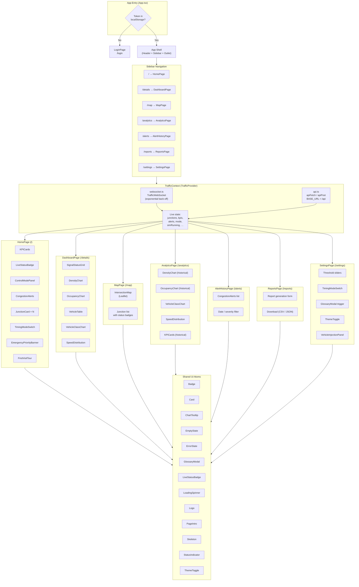

# Frontend Structure

> **Files read to produce this diagram:**
> - `frontend/src/App.tsx` — routes, auth gate, layout wrapper
> - `frontend/src/context/TrafficContext.tsx` — context fields, WebSocket + REST polling
> - `frontend/src/services/api.ts` — `BASE_URL`, `apiFetch`, `apiPost` helpers
> - `frontend/src/services/websocket.ts` — `TrafficWebSocket` class with exponential back-off
> - `frontend/src/pages/` — all page components (HomePage, DashboardPage, MapPage,
>   AnalyticsPage, AlertHistoryPage, ReportsPage, SettingsPage, LoginPage)
> - `frontend/src/components/` — all widget and UI-atom components

---

## Page and Component Map

---

## Service Layer

| File | Role |
|---|---|
| `services/api.ts` | Thin fetch wrapper — `BASE_URL = '/api'`; `apiFetch(path)` for GET, `apiPost(path, body)` for POST. All REST calls go through here. |
| `services/websocket.ts` | `TrafficWebSocket` class — connects to `ws[s]://host/ws/live`, parses JSON frames, calls registered listeners, reconnects with exponential back-off on close/error. |
| `context/TrafficContext.tsx` | `TrafficProvider` owns the WebSocket instance and REST polling intervals; exposes a single React context used by every page and widget. |

## Auth Gate

`App.tsx` reads `localStorage.getItem('intelliroads_token')`. If absent the user is redirected to `LoginPage`. On successful login the token is stored and the user enters the main app shell.

## Routing

React Router v6 nested routes. The outer `<Route>` renders `Header` + `Sidebar` + `<Outlet>`; each page is a child route. The sidebar renders navigation links for all 7 pages. No lazy-loading of route chunks was observed in `App.tsx`.
